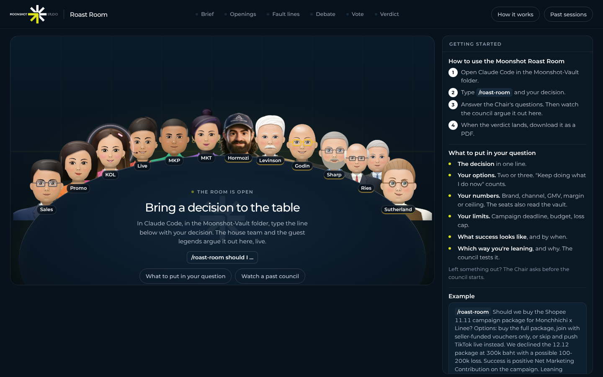

# Moonshot Roast Room



Moonshot Studio's board room. Bring a hard decision and the table argues it out: your **six house experts** (the vault's `moonshot-*` team) plus **guest legends** built from public work. Then a Chair hands you a scored verdict with owners, dates, dissent and kill criteria, and a one-click PDF. The council runs in Claude Code inside the Moonshot vault, and a small local web app shows the seats around a table talking it through.

## The table

**House seats** argue from the vault's measured numbers (Quick-Context, the latest meetings, Margin-and-Discount-Ceilings, their own `MEMORY.md`) and a researched brain on Thai e-commerce.

| Seat | Team role | Pillar | The question they own |
|---|---|---|---|
| Sales | `moonshot-sales` | Sales performance and forecast | Does this close the gap to target at a contribution we can bank? |
| Promo | `moonshot-promotion` | Pricing and promotion | Is it above the margin floor, and is the uplift truly incremental? |
| KOL | `moonshot-kol` | KOL, creators and affiliates | Can the SKU fund the creator, and which creators actually move GMV? |
| Live | `moonshot-live` | Live commerce | Does it pay per live hour, and can the MCs run it? |
| MKP | `moonshot-mkp` | Marketplace operations | Do the fees, rules and shop health allow it? |
| MKT | `moonshot-mkt` | Marketing and growth | Is the spend incremental on contribution, and does it build the brand? |

**Guest seats** are simulations built from each person's public work, with every quote tied to a source id in their brain:

| Seat | Pillar | The question they own |
|---|---|---|
| Alex Hormozi | Offers, pricing, and sales | Will people pay, how much, and how do we close? |
| Jay Conrad Levinson | Capital-scarce growth | What can time, energy and imagination do instead of money? |
| Seth Godin | Product and launch | Is it remarkable, and who exactly is it for? |
| Byron Sharp | Brand growth evidence | Does it grow penetration, and are we easy to find and remember? |
| Ries & Trout | Positioning and category | Which word do we own, and which battle are we choosing? |
| Rory Sutherland | Reframing and signalling | What perception could we change instead of the product? |

A full council seats the six house experts plus the two guests whose doctrine fits the decision (the regime table from the marketing doctrine committee picks them).

## Install into the vault (once)

You need [Claude Code](https://claude.com/claude-code) and [Node.js](https://nodejs.org) 20 or newer.

```bash
git clone https://github.com/Sudio88/Roastroom.git
cd Roastroom
bash install.sh      # or: bash install.sh "/path/to/Moonshot-Vault"
```

It adds the skill and 12 brains to `Moonshot-Vault/.claude/skills/roast-room/`, the 12 seat agents to `.claude/agents/`, the room app to `Moonshot-Vault/Roast-Room/`, merges two permission rules into `.claude/settings.json`, and appends a short "Roast Room" section to the vault's `CLAUDE.md`. It never overwrites your `moonshot-*` expert agents or any vault note. Run it again after pulling updates.

## Run a roast

1. Start the room: `cd Moonshot-Vault/Roast-Room && npm start`, then open http://localhost:4740.
2. Open Claude Code in the vault folder.
3. Type `/roast-room` and your decision. The Chair reads Quick-Context and the latest meetings first, then asks only for what is missing.
4. Watch the house and the guests argue it out in the room.
5. When the verdict lands, click **Download PDF**. The full report is in `Roast-Room/sessions/<date>-<decision>/verdict.md`.

Example:

```
/roast-room Should we buy the Shopee 11.11 campaign package for Monchhichi x Linee?
Options: full package, seller vouchers only, or skip and push TikTok live.
We declined 12.12 at 300k baht with a possible 100-200k loss. Leaning vouchers only.
```

More ways to run it:

- `/roast-room --quick ...` four seats, two rounds. For reversible calls.
- `/roast-room --house ...` the six house experts only.
- `/roast-room --committee ...` the five doctrine voices (Levinson, Godin, Sharp, Ries & Trout, Sutherland) plus the two house seats that own the numbers.
- `/roast-room --all ...` all twelve seats (about 36 sub-agent runs).
- `/roast-room --seats promo,kol,hormozi ...` exactly those seats.
- `/roast-room ask sharp ...` one answer from one seat.

`/council` and `/ask` stay your fast path for everyday questions; the Roast Room is for decisions worth a scored debate.

## How it works

- **The council runs in Claude Code.** Each seat is a sub-agent (`.claude/agents/council-*.md`) with a brain (`.claude/skills/roast-room/brains/<slug>/`). House seats also load their vault role file, `TEAM-PROTOCOL.md` rules, their `MEMORY.md` and the newest vault notes, so the vault always beats the brain when it is newer.
- **Each seat scores every option**, weighted by how much its pillar matters to the decision. Hard limits are not up for a vote: a seat flagging a discount-ceiling, Monchhichi licence, Thai FDA claim or platform-policy breach caps the verdict.
- **Citations are checked.** `python3 .claude/skills/roast-room/scripts/check_quotes.py <session>` verifies every guest quote against its brain and every `[[vault link]]` against the vault.
- **Learning loop.** After the verdict the Chair may add one dated line per house seat to its `MEMORY.md`, per your team protocol, and offers a ready-to-paste decision note. It never edits vault notes.
- **The room only watches.** It plays the session files back as they land and makes no AI calls of its own (unless you turn on the API runner below).
- **Usage:** a full council (8 seats, 3 rounds) is 24 sub-agent runs. Use `--quick` for small calls.

## The research behind the brains

`reports/Moonshot council seat expertise.md` is the research report the house brains were built from: the vault's measured numbers and decisions plus 2024 to 2026 external research for each pillar, with evidence grades and the gaps that still need Seller Centre or internal data. Raw notes are in `research_notes/`. External figures came largely from search summaries and are marked to re-verify.

## Optional: let the room run councils itself

Copy `.env.example` to `.env` in the room folder, add an `ANTHROPIC_API_KEY`, set `COUNCIL_RUNNER=api`, and restart `npm start`. That mode bills your Anthropic API account. In API mode the seats cannot read the vault, so house seats argue from their brains and the brief only.

## What's inside

| Path | What |
|---|---|
| `.claude/skills/roast-room/` | The skill: protocol, prompts, scoring, report template, checker, and the 12 brains |
| `.claude/agents/` | The 12 council seat agents, plus copies of the six `moonshot-*` expert definitions |
| `app/` | The room: a zero-dependency Node server, the web page, and the PDF builder |
| `install.sh` | Installs everything into the vault |
| `reports/`, `research_notes/` | The research behind the house brains |

## About the seats

House seats are AI experts grounded in Moonshot's vault; they are not your team members and do not speak for them. Guest seats are simulations built from public work. They are not the people, they do not speak for them, and none of them is affiliated with or endorses this project. Each brain's `sources.md` lists what it was built from.

Forked from [Roast Room](https://github.com/nateherkai/roast-room) by AI Automation Society (MIT; see `LICENSE`). The PDF builder bundles [jsPDF](https://github.com/parallax/jsPDF) (MIT) and [Montserrat](https://github.com/JulietaUla/Montserrat) (SIL Open Font License); their licenses sit next to them in `app/public/`.
